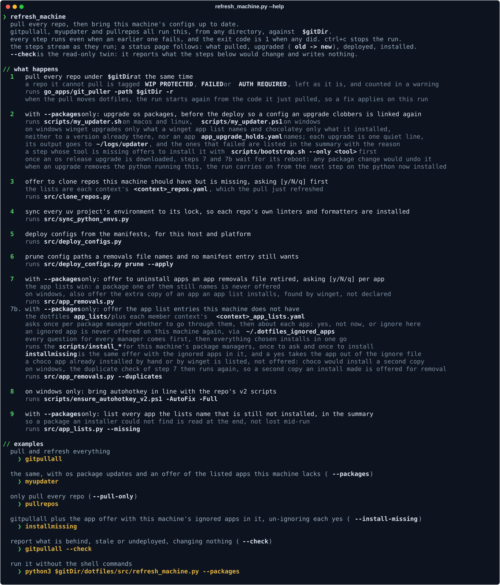
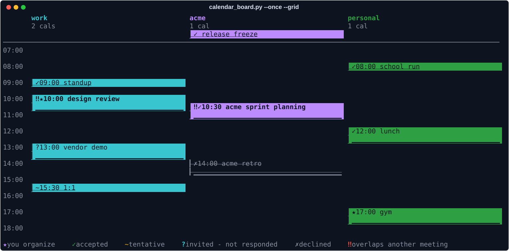

# dotfiles

Personal dotfiles plus the tooling that keeps a fleet of machines configured
the same way. One repo, cloned onto every machine I use (personal, homelab and
work), carries the app configs, the package lists per platform, the setup
docs, and the Python, Go and shell tools that pull, deploy and check all of
it on macOS, Linux, WSL, Windows, Android (Termux), Raspberry Pi and iPad
(Pythonista).

It is a portable knowledge base as much as a config store: it codifies things
I know how to do and carries the configs and tooling every context depends
on. Anything specific to one context (secrets, host inventories, client
configs) comes from private sibling `*_credentials` repos layered on top, so
this repo stays context-free and public. See
[`docs/repo_philosophy.md`](docs/repo_philosophy.md) for what belongs here
versus in sibling repos.

## What it does

- **Deploys configs as links.** `src/deploy_configs.py` reads
  `deploy_manifest.yaml` plus an overlay manifest from each sibling
  `*_credentials` repo and links every config into place for the current
  host and platform. Host- and platform-specific variants use the
  `<base>.<token>.<ext>` naming scheme and resolve automatically (exact
  hostname, then platform, then the bare default). `status` is a read-only
  drift report; `prune` removes links no manifest wants any more.
- **Refreshes a machine in one command.** `src/refresh_machine.py` (the
  `gitpullall`, `myupdater`, `pullrepos` and `installmissing` shell commands)
  pulls every repo in parallel with `go_apps/git_puller`, optionally upgrades
  OS packages, offers to clone missing repos, syncs each uv project to its
  lock, deploys, prunes, and offers installs and uninstalls from the app
  lists. `--check` reports what would change and writes nothing.
- **Keeps package lists per platform.** `app_lists/` holds the Brewfile,
  apt, dnf, flatpak, Chocolatey, winget, MSYS2 and Termux lists;
  `app_removals.yaml` retires packages across the fleet.
- **Bootstraps a bare machine.** `scripts/bootstrap.sh` (macOS, Linux, WSL,
  Termux) and `scripts/bootstrap.ps1` (Windows) clone, sync, deploy and
  install packages. Every step is idempotent, so a second run is a repair.
- **Carries portable tools** that any machine in any context can run, for
  example `ticket_pr.py` (a stdlib-only Jira and GitHub/Bitbucket ticket and
  PR harness), `ssh_aliases.py` (ssh and VNC aliases from the host
  inventories), `fleet_check.py` (one read-only check across every reachable
  machine) and local MCP servers for Google and macOS apps.
- **Documents setups.** `docs/` has one how-to per topic, indexed in
  [`docs/README.md`](docs/README.md).



The calendar board (`src/calendar_board.py`), shown here with sample data,
puts several calendar accounts side by side with attendance badges and
flags meetings that overlap across accounts:



## Repository layout

| Path | Purpose |
|------|---------|
| `src/` | Python tools: the deploy pipeline, machine refresh, calendar and Gmail tools, MCP servers, and the stdlib-only helpers the shells call at startup. Shared helpers come from the [`readable-utils`](https://github.com/ReadableCode/readable_utils) package. |
| `scripts/` | Shell, PowerShell and AutoHotkey scripts for install and maintenance tasks, including the bootstrap and package installers. |
| `application_configs/` | Source-of-truth configs for bash, zsh, nvim, tmux, git, PowerShell, ssh, Claude Code and more. |
| `app_lists/` | Package manifests per platform. |
| `go_apps/` | Small Go tools (`git_puller`, a cleanup of Syncthing conflict and temp files) with prebuilt binaries committed so a fresh machine needs no Go toolchain. |
| `docs/` | Setup and how-to docs, one topic per file. |
| `tests/` | pytest suite. |
| `pythonista/` | iOS Pythonista scripts. |

## Getting started

On a bare machine, the bootstrap scripts do everything:

```bash
curl -fsSL https://raw.githubusercontent.com/ReadableCode/dotfiles/master/scripts/bootstrap.sh | bash
```

```powershell
# elevated PowerShell
iwr -useb https://raw.githubusercontent.com/ReadableCode/dotfiles/master/scripts/bootstrap.ps1 | iex
```

From an existing clone, preview first with `bash scripts/bootstrap.sh
--dry-run` (or `.\scripts\bootstrap.ps1 -DryRun`). After that, `gitpullall`
keeps the machine current.

## Running with uv

This project uses [uv](https://docs.astral.sh/uv/) for dependency and
environment management. Python version is pinned in `.python-version`.

* Install uv:

  Linux / macOS:

    ```bash
    curl -LsSf https://astral.sh/uv/install.sh | sh
    ```

  Windows (PowerShell as admin):

    ```powershell
    powershell -ExecutionPolicy ByPass -c "irm https://astral.sh/uv/install.ps1 | iex"
    ```

* Install dependencies (creates the virtual environment from `pyproject.toml`
  and `uv.lock`):

  ```bash
  uv sync
  ```

* To run a script (uv resolves the environment automatically, no activation
  needed):

  ```bash
  uv run python src/deploy_configs.py status
  ```

* To add or remove a dependency (updates `pyproject.toml` and `uv.lock`):

  ```bash
  uv add <package>
  uv remove <package>
  ```

* To enter a shell inside the virtual environment:

  On Linux / macOS:

  ```bash
  source .venv/bin/activate
  ```

  On Windows (PowerShell):

  ```powershell
  .venv\Scripts\Activate.ps1
  ```

* To deactivate:

  ```bash
  deactivate
  ```

## Running Tests

* **`tests/`**: fast unit tests with no external dependencies. A default
  `pytest` run collects only these (configured via `testpaths` in
  `pyproject.toml`), so they're safe to run anywhere, including CI.

  ```bash
  uv run pytest                                       # full unit suite
  uv run pytest tests/test_deploy_configs.py          # a specific file
  ```

## Bitwarden backup (moved)

The Bitwarden vault backup job (`src/bitwarden.py`,
`Dockerfile-bitwarden_backup`, and the manual `bw export` instructions) is a
homelab-only job and lives in the local `personal_dev` repo
(`~/GitHub/personal_dev`), along with the Minecraft log tooling. See
that repo's README for the Docker build/run commands and the cutover
checklist. Dotfiles itself stays focused on what every device needs: config
deploy/pull and repo pulling.
